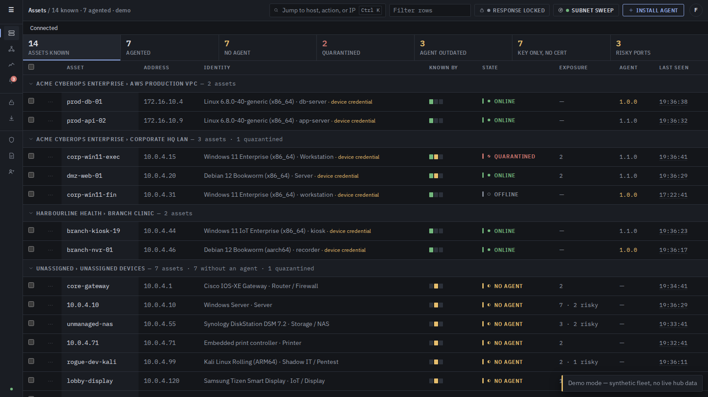

# Elias Leslie: Security Leadership, Incident Response, and AI and Security Software

I am a former CISO and incident commander with 25 years in IT and cybersecurity. Since August 2025 I have designed, built and run AI platforms and security software as a solo developer under SummitFlow Solutions. I use coding agents as engineering tools, and I own the work end to end: requirements, architecture, implementation, testing, release and operation.

The projects below run together as a self-hosted platform that I use every day to build, test, release, back up and operate 30+ registered internal projects. I am open to building tools like these for other teams.

## Background

I spent 18 years at Network People, a managed service provider serving 200+ client organizations, through and after its 2024 acquisition by Integris. As Director of IT (2007 to 2018) I directed the company's IT and owned infrastructure, governance and service delivery for the client organizations it served. As Chief Information Security Officer (2018 to 2024) I built the company's security program and incident-response practice from the ground up, set security policy for the staff and served as fractional CISO for client organizations. Integris retained me as Security Services Architect (February 2024 to August 2025) to carry that security architecture, automation and team forward, and I refactored our RMM-dependent response, forensic and monitoring tools to run through any RMM, Microsoft Intune or as standalone binaries.

As incident commander I led or supported about 30 ransomware and breach responses, typically restoring about 80% of business capability within days. Many were referred through a cyber insurer in the Lloyd's of London market, including enterprise organizations with 10,000+ endpoints and seven-figure ransom demands. I directed client engineering teams, outside IT providers and vendors across 26 states and multiple countries. OSCP certified.

## Public projects

Seven public repositories. Five are released under Apache-2.0 (Agent Hub, SummitFlow, Tether, A-Term and Aico). SHA and Ominull are source-available under the Business Source License 1.1. Each has documented setup, tests, CI, stated limitations and a security policy.

### Agent Hub: self-hosted control plane for multi-provider AI agents

[Repository](https://github.com/elias-leslie/agent-hub) · [Security policy](https://github.com/elias-leslie/agent-hub/blob/main/SECURITY.md)

- **Problem:** Most agent demos stop at chat. Running agents as real infrastructure needs provider routing, persistent memory, sessions, access control, governed context and cost visibility in one place.
- **Solution:** A self-hosted control plane for AI agents across cloud and local model providers: catalog-driven routing, semantic memory, sessions, committee reviews and agentic tool loops, one governed path for the context that reaches coding agents, access control, spending limits, cost accounting and operator dashboards.
- **Stack:** FastAPI, Python 3.13, Next.js 16, React, TypeScript, PostgreSQL with pgvector, Redis, Hatchet, pnpm, uv, plus a sync and async Python SDK.
- **Routing and providers:** Completions and SSE streaming across configured cloud providers and local OpenAI-compatible endpoints, with catalog-driven model resolution, per-agent fallbacks, a provider circuit breaker and runtime health checks, plus image generation adapters. Anthropic/Claude is catalogued for reference and deliberately excluded from workload routing; Claude Code runs instead as an external worker that launches the official CLI.
- **Agents and memory:** A pgvector semantic memory store whose episodes can be archived and restored; stateful sessions with history and branching; named personas and versioned prompts; an agentic server-side tool loop (shell, files, code search, web research) that can hand work to other agents as child sessions; and committee reviews that combine several agents' views on one question.
- **Governed context delivery:** A single selector and renderer decides which prompts and memory reach Claude Code, Codex, Google Antigravity, Pi, MCP clients and internal agents, with exact previews, revision-checked saves and undo.
- **Operability and cost:** Boots without provider keys; encrypted credential storage, per-project permissions, per-project daily and monthly budgets and per-agent request and token limits; cost accounting that covers metered spend, subscription plans and an ingest endpoint for model calls paid for outside Agent Hub; cost, latency and request dashboards; and Hatchet background workflows.
- **Notable engineering decision:** The memory layer originally ran on a Neo4j/Graphiti knowledge graph. I migrated it to a unified pgvector store, removing an entire second datastore from the deployment while keeping the retrieval semantics.
- **Design stance:** The individual capabilities exist elsewhere in pieces: Langfuse does tracing, LiteLLM proxies providers, OpenRouter hosts routing. Agent Hub's bet is that routing, memory, sessions, context governance and cost accounting belong together in one self-hosted control plane rather than stitched together across several services.
- **Skills demonstrated:** Multi-provider routing, credential boundaries, memory and session infrastructure, context governance, schema migration under live semantics, SDK design, operability and observability.
- **Security relevance:** Isolates provider credentials behind access-control surfaces, boots without provider keys (dashboards, health and sessions stay available) and reports optional integrations as unavailable when they are not configured.
- **Status:** Public Apache-2.0 release. Works standalone and as SummitFlow's routed-agent backend. Expose beyond loopback only behind a reverse proxy with strong client and internal secrets.

### Security Hardening Automation (SHA): early-stage, bounded control plane for endpoint hardening

[Repository](https://github.com/elias-leslie/sha) · [Security policy](https://github.com/elias-leslie/sha/blob/main/SECURITY.md)

- **Problem:** Endpoint hardening often becomes a brittle mix of one-off scripts, undocumented baseline assumptions, risky remote access, and unclear rollback paths.
- **Solution:** SHA is an early-stage control plane that models hardening as a *bounded* process: enroll endpoints, collect posture, browse curated controls, generate installer profiles, and route every disruptive action through a typed human approval gate.
- **Stack:** FastAPI, Python 3.13, SQLAlchemy, Alembic, Pydantic, a cross-compiled Go endpoint agent, Next.js 16, React 19, TypeScript, Vitest, pnpm, uv.
- **What was built:** A control-plane API and operator dashboard covering fleet and endpoint inventory, controls, installer profiles, approvals, and response-action history. Generated Windows, Linux, and macOS compatibility reporters run concrete read-only posture checks (host firewall, SSH configuration, root password lock, automatic updates, Microsoft Defender, BitLocker, Secure Boot, FileVault, Gatekeeper) through an enroll → heartbeat → posture → action-claim → lease-bound-result cycle. A deterministic, provenance-pinned catalog builder produces 4 starter control packs (17 controls) from public NIST SP 800-53 Rev. 5, DISA Windows Server 2022 STIG, and CISA/NSA guidance, each control carrying NIST CSF / SP 800-53 / STIG / CISA mappings. A typed human-in-the-loop approval workflow has bounded grant TTLs (15 to 240 minutes), manual emergency grants, and append-only audit events. Action delivery is lease-bound and idempotent, behind fail-closed OIDC browser sessions with scoped roles and CSRF/origin enforcement. Linux and Windows have reversible typed hardening actions with rollback artifacts; macOS is observe-only. Posture rolls up into weighted per-endpoint scores and a control drift matrix. A cross-compiled Go agent with enrollment tokens, per-device credentials, and signed release bundles is the path that replaces the compatibility reporters.
- **Demonstrable without a fleet:** The console ships an explicitly enabled demo mode that answers every read from an invented tenant set and refuses every mutation, so it can be screen-shared or published without exposing a real deployment. The screenshot above is that mode.
- **Design stance:** The API has no shell, remote-desktop or arbitrary-command endpoint, and a route test checks that none is registered. I removed earlier simulated terminal, remote-desktop and network-scan routes because they did not go through typed, approval-gated actions. SHA sits deliberately between pure auditors (Lynis, OpenSCAP) and unbounded appliers (ansible-lockdown, Wazuh active response): every disruptive action is a typed capability behind a mandatory approval gate.
- **Skills demonstrated:** Security automation design, public-source provenance discipline, approval-boundary modeling, cross-platform agent development, full-stack testing, and clean install verification.
- **Status:** Early-stage working control-plane slice, not a production-ready endpoint-management product. Linux and Windows have typed, reversible actions; macOS is observe-only and refuses any change. Native DEB/RPM/MSI distribution, a signed macOS package and broader production readiness remain open. Source-available under the Business Source License 1.1.

### Ominull: self-hosted endpoint telemetry, detection, and containment hub

[Repository](https://github.com/elias-leslie/ominull) · [Security policy](https://github.com/elias-leslie/ominull/blob/main/SECURITY.md)

- **Problem:** Operators of small Linux and Windows fleets need to see which programs talk to which networks, notice the behavior that matters, and contain a host when needed, without sending fleet data to a hosted EDR service or losing the ability to recover the host.
- **Solution:** A self-hosted Linux hub with native Linux and Windows agents, running on my own endpoints. It combines a fleet console, observed communication evidence, per-device identity, behavioral detection with operator tuning, and bounded response controls.
- **Stack:** Go hub with an embedded operator console and SQLite store; C endpoint agents for Linux and Windows; signed Linux `.deb` and Windows `.msi` packages; systemd; OIDC and optional Cloudflare Tunnel/Access.
- **Telemetry and evidence:** Agents report TCP socket-counter observations and passive UDP socket observations (a libbpf CO-RE program on Linux, an ETW consumer on Windows) with process attribution and stated coverage limits. Observation records are bounded evidence, not packet capture or proof of complete network visibility. A topology workspace groups communication by asset, network, and process without merging hosts on a shared name, and optional router telemetry adds DHCP leases, conntrack flows, and DNS answers without putting the hub in the network path.
- **Detection:** Per-process transfer baselines scored with a robust modified z-score (median and MAD), beaconing detection that requires both regular timing and uniform payload size, agent-silence alerts, threat-intelligence and published network-attribution matching, and an on-demand subnet scanner that shows the evidence behind each identification. Learning windows produce tuning proposals that apply only when an operator accepts them.
- **Response:** Host isolation is gated by a readiness check: the hub compares the services an endpoint uses against its baseline policy and rejects isolation that would break something uncovered, unless an administrator records an audited emergency override. Linux applies Ominull-owned iptables/ip6tables rules and Windows applies user-mode Windows Filtering Platform rules. A dead-man timer releases isolation if the hub becomes unreachable, a standalone Windows recovery tool removes only Ominull's filters, and mesh quarantine lets retained agents block a named peer. Privileged response actions go through a separate response-authority service.
- **Identity and lifecycle:** Enrollment profiles (invitation, campaign, deployment) issue a unique device credential and a matching client certificate per endpoint. The bootstrap verifies the package digest and detached ECDSA signature before invoking `dpkg` or Windows Installer, and agents self-update only after checking the package against a release key pinned in the binary.
- **Engineering decisions:** During early development I built and verified a prototype Windows Filtering Platform kernel callout driver (C, WDK), then scoped the shipped product to user-mode enforcement. I also removed DPI code, an embedded AI copilot, macOS support, policy groups that only labeled traffic and an SSH push deployer, described the remaining enforcement exactly as implemented, and finished native package lifecycle for the platforms that stayed. Separately, I replaced repeated history scans with an indexed query: synthetic 100,000-profile lookups dropped from about 21 milliseconds to 11 microseconds, with regression tests confirming unchanged decisions.
- **Skills demonstrated:** Go and C systems programming, Linux and Windows network telemetry, robust statistics for detection, kernel and user-mode Windows Filtering Platform work, safe containment design, device PKI and signed package lifecycle, and deliberate scope reduction.
- **Security relevance:** Keeps fleet telemetry on infrastructure the operator controls, uses unique per-device credentials and client certificates, fails closed on unsafe isolation, and keeps a recovery path for every enforcement state it creates.
- **Status:** Supported products are the Debian-family Linux hub `.deb`, Linux agent `.deb`, and Windows agent `.msi`. macOS is out of scope. Source-available under the Business Source License 1.1.

### SummitFlow: task orchestration and evidence capture for AI-assisted development

[Repository](https://github.com/elias-leslie/summitflow) · [Security policy](https://github.com/elias-leslie/summitflow/blob/main/SECURITY.md)

- **Problem:** AI-assisted development scatters task state, quality gates, and verification evidence across one-off scripts and chat logs, so it is hard to see what was actually built, checked, and proven across projects.
- **Solution:** The task orchestration and software-delivery platform behind the rest of this portfolio. It tracks tasks, subtasks, steps and dependencies; runs quality gates and code-health scans; coordinates parallel agents; records durable receipts before dispatch and recovers interrupted work; binds test, deployment and live-check evidence to the exact commit verified; and blocks irreversible agent actions such as unreviewed publication and destructive commands. Built for developers running their own agent tooling, not as a hosted SaaS.
- **Stack:** FastAPI, Python 3.13, SQLAlchemy, Alembic, Next.js 16, React, TypeScript, PostgreSQL, Redis, Hatchet, pnpm, uv, plus a Rust host monitor.
- **What was built:** A FastAPI backend (about 300 API routes) and a Next.js operator UI, driven by the `st` CLI with 80+ top-level commands spanning task lifecycle (claim leasing, dependencies, JSONB-stored verification/review evidence, cross-agent coordination and a preflight gate), quality gates (ruff, types, pytest, biome, tsc, vitest, sqlfluff, squawk, CodeQL alert state, and an isolated cleanroom run), checked Git checkpoints with explicit publication, services and runtime, databases and migrations, browser/UI automation, agents, file-level leases, and backups.
- **Automation and operations:** Hatchet workflows for maintenance (stale-claim reset, code-explorer scans, search-index refresh, backups, retention, production smoke tests, runtime hygiene) and Agent Hub automation dispatch; `radon` complexity assessment, code-graph topology and JS/TS dead-code audits, and precision symbol/endpoint/table search; Btrfs per-project snapshots and age-encrypted offsite backups with a monthly restore test and documented disaster recovery; and `summitflow-host-monitor`, an unprivileged Rust collector for host, service, and process metrics.
- **Design stance: proof it ran.** The differentiator is evidence, not tracking. Managed browser checks capture screenshots, page snapshots, and console state; quality-gate and review results are stored as JSONB on the task, so "done" points to evidence a reviewer can open, not a status field someone set. Agents always claim work explicitly; SummitFlow does not pick up or generate tasks on its own.
- **Skills demonstrated:** Full-stack system design, workflow orchestration, CLI and developer-tooling design, runtime smoke verification, and public release discipline (secret/history scanning, dependency remediation, clean install verification).
- **Security relevance:** Keeps agent work local-first and auditable, and degrades clearly when optional integrations (Agent Hub, Hatchet, browser runtime, push notifications, SMB backups) are absent instead of exposing credentials or crashing unrelated pages.
- **Status:** Public Apache-2.0 release. Pairs with Agent Hub for routed AI completions and shared memory, but runs standalone.

### Tether: session daemon behind A-Term and Aico

[Repository](https://github.com/elias-leslie/tether) · [Security policy](https://github.com/elias-leslie/tether/blob/main/SECURITY.md)

- **Problem:** A-Term and Aico each grew their own tmux lifecycle, so the same agent session had two owners, two catalogs and two ways to end it, and the apps had to federate with each other to see each other's work.
- **Solution:** A per-user Linux daemon that owns every durable terminal session. The apps keep only their views (Aico windows, A-Term panes) and ask Tether to create, rename, resize and end sessions. Either app works alone against Tether, and both can share one instance.
- **Stack:** TypeScript on Node.js 22 (`node:sqlite`), esbuild single-file bundle, systemd user units, cgroup v2, tmux; Python operator scripts.
- **What was built:** A versioned HTTP API on a private 0600 Unix socket, never exposed on the network; private tmux servers in their own systemd units with one scope per pane and a memory guard; generation fencing, so every mutation names the exact workload it read and a changed workload is never a retry target; explicit End and respawn, with no silent resurrection; root requests with tombstones, so a retried request ID reconciles instead of launching twice; a shared agent-tool registry and a project list sourced from SummitFlow when installed; an event stream with gap resync; an active-client resize claim; a GUI channel that forwards show, position and title to the connected Aico desktop; and the legacy Aico control sockets kept for existing callers. An idempotent importer moved Aico's catalog over during a live cutover in which the running sessions kept their identities.
- **Design stance:** One authority for the workload, many views of it. Closing a window or a browser tab only detaches a client; ending a session is a separate, explicit action that Tether performs whichever app asks.
- **Skills demonstrated:** Process containment with systemd and cgroups, API and compatibility-contract design, idempotent data migration, and a live cutover that kept running sessions attached.
- **Security relevance:** Socket-only API with 0600 permissions, an allow-listed environment for every tmux server, no app `.env` loading, and contained process trees that End can retire completely.
- **Status:** Early release under Apache-2.0 (API v1) with CI passing, in daily use on my workstation since October 2026, where it owns every Aico and A-Term session. There is no tagged release yet. Runs on Linux with systemd 254+, cgroup v2 and user lingering. Install it before A-Term or Aico.

### A-Term: browser workspace for AI coding agents

[Repository](https://github.com/elias-leslie/a-term) · [Security policy](https://github.com/elias-leslie/a-term/blob/main/SECURITY.md)

- **Problem:** Agentic coding needs several shells and agents next to project files in one place you can reach from any device, and naive web terminals lose their session the moment the tab closes.
- **Solution:** A self-hosted browser workspace that shows persistent terminal sessions (Claude Code, Codex, Antigravity, Pi, and shells) side by side in a resizable pane grid, with a file browser, voice input and full mobile support. The sessions live in Tether, so they keep running when the browser closes, and the same sessions open in Aico.
- **Stack:** FastAPI, Python 3.13, SQLite, Next.js 16, React 19, TypeScript, xterm.js (WebGL), tmux, Tailwind CSS 4, pnpm, uv; Tether for sessions.
- **What was built:** WebSocket PTY terminals that attach to Tether's tmux sessions, so sessions survive browser and server restarts; up to six resizable panes with detach-to-window; per-pane shell or agent mode using Tether's shared tool registry; a view-state store (panes, layout, project display settings) in a local SQLite file, with no database server; a sandboxed file browser with validated uploads; Agent Hub prompt cleaning; browser-native voice input; an on-screen keyboard and PWA install for mobile; and three auth modes (loopback, password, proxy) with security headers, CSP and rate limiting. The move to Tether removed Postgres, the notes and prompt library, and session recording.
- **Design stance:** Browser terminals, modern desktop terminals and tmux each solve one part of this. A-Term is not trying to replace a terminal emulator. It puts several agents, durable sessions and project files into one workspace reachable from any device, self-hosted, with no account or cloud service.
- **Skills demonstrated:** Real-time WebSocket/PTY streaming with backpressure, client design against a session daemon, data migration off Postgres, mobile/PWA support, and secure-by-default remote access.
- **Security relevance:** Ships loopback-only by default, isolates the file browser against path traversal, keeps A-Term authentication on every route that reaches Tether, and keeps agent working context local instead of in a hosted service.
- **Status:** Public Apache-2.0 release. Requires Tether API v1. Projects come from SummitFlow when installed, otherwise from Tether's local list; Agent Hub adds prompt cleaning and a model catalog.

### Aico: desktop companion for terminal AI agents

[Repository](https://github.com/elias-leslie/aico) · [Security policy](https://github.com/elias-leslie/aico/blob/main/SECURITY.md)

- **Problem:** Terminal AI agents are useful but fragmented across shells, browser context, desktop selection and project state, and the thing you want the agent to look at is almost always already on your screen.
- **Solution:** A Linux desktop companion that shows terminal AI CLIs (Claude Code, Codex, Gemini/Antigravity, Pi, and shells) in floating "lantern" widgets, then lets you tag a browser page, a selection, a window or a screen region straight into the running agent's prompt. Each widget is a view of a Tether session, so the same session also opens in A-Term.
- **Stack:** Electron, TypeScript, Vite, xterm.js, node-pty, FastAPI, Python 3.13, SQLite, tmux, uv, Node.js, MV3 browser extension APIs; Tether for sessions.
- **What was built:** Frameless terminal widgets that attach to Tether sessions and remember their geometry per session; closing a widget only detaches, so work reattaches across close, reopen and restart; one session list covering everything started from Aico, A-Term, the `tether` CLI or a SummitFlow root; a searchable command palette and pinned, drag-reorderable controls over one action registry; an agent launcher that swaps the TUI in a focused widget; Tether's lifecycle diagnostics (tmux target, scope, age, CPU and memory, containment warnings) one click away; a read-only scrollback overlay; a loopback FastAPI sidecar and MV3 browser extension for click-to-context capture; optional desktop window, region and OCR grab and voice dictation; and an AppImage build with a bundled PyInstaller sidecar, CI and release hardening (SHA256SUMS and build provenance).
- **Design stance:** Deliberate, on-demand tagging rather than always-on recording. Screen-history tools capture everything and make you search it later; other launchers route capture into their own chat. Aico's target is *your* terminal agent, on Linux, with capture happening only when you ask for it.
- **Skills demonstrated:** Desktop/Electron integration, local sidecar API design, client design against a session daemon, browser-context capture, and release hardening.
- **Security relevance:** Keeps sensitive workflow state local by default, uses loopback APIs and a private socket, captures only on explicit action, and degrades when optional integrations are absent.
- **Status:** Public Apache-2.0 release for single-user Linux desktops. Requires Tether API v1. X11 is the best-supported path for global shortcuts and desktop capture; Wayland has limitations.

## Private projects

These repositories are private. I am happy to discuss or demo any of them in an interview.

- **BlackBox:** An encrypted media archive with a Kotlin Android client and a Go vault service. Media is encrypted on the device with AES-256-GCM under Android Keystore keys, devices identify themselves with P-256 keys over fingerprint-pinned TLS, and offline recovery uses Argon2id. The vault never holds a media decryption key, and the design follows a written threat model with four security invariants.
- **Neri:** A research platform for authorized bug-bounty work (FastAPI, PostgreSQL, Next.js, Hatchet). It tracks program scope and policy, preserves evidence, keeps stable finding identities and ties independent reviews to the exact report revision examined, with idempotent requests and recovery after uncertain dispatch.
- **Code Intelligence:** Python AST and TypeScript/TSX symbol extraction and repository retrieval that checks results against current source, with regression fixtures and a fixed-corpus evaluation that answered 176 of 176 lookup workflows.
- **Portfolio AI:** A household finance and investment workspace with tax-lot P&L, wash-sale checks, retirement Monte Carlo and backtested signals. Every number is computed in code, and AI output is labeled separately.

## Capability areas

- **Security leadership:** security program design, fractional CISO advisory, executive and board risk communication, incident command, third-party risk, CMMC/DFARS/HIPAA/PCI/CJIS compliance.
- **Security automation:** endpoint hardening, control-catalog provenance, approval boundaries, incident containment, detection workflows, evidence exports, rollout/rollback discipline.
- **AI automation and agentic tooling:** multi-provider control planes, local-first agent workflows, prompt/session/memory infrastructure, terminal and browser context capture, supervised automation boundaries.
- **Cyber security engineering:** secure defaults, applied cryptography and key management, device PKI, secret scanning, local API boundaries, signed package and install-time verification, public release hygiene.
- **Full-stack infrastructure:** FastAPI, Go, Next.js/Electron, PostgreSQL/pgvector/Redis/SQLite, workflow orchestration, operator dashboards, Linux service and runtime integration.

## Contact

- LinkedIn: <https://linkedin.com/in/elias-leslie>
- GitHub: <https://github.com/elias-leslie>

_Last updated: 2026-10-11_
