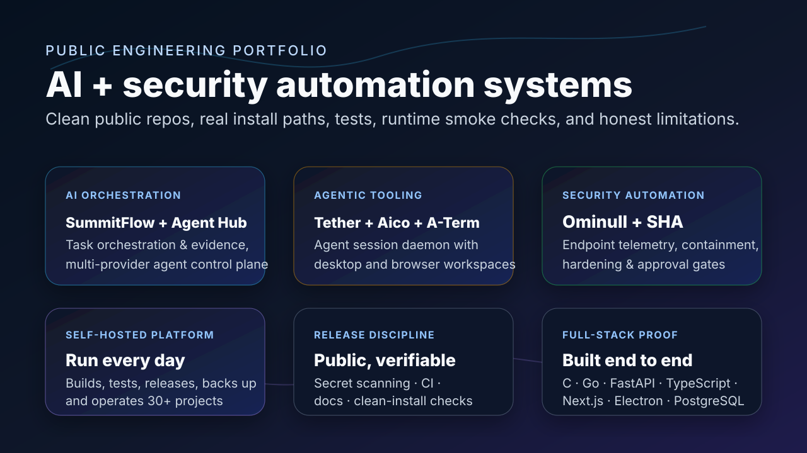
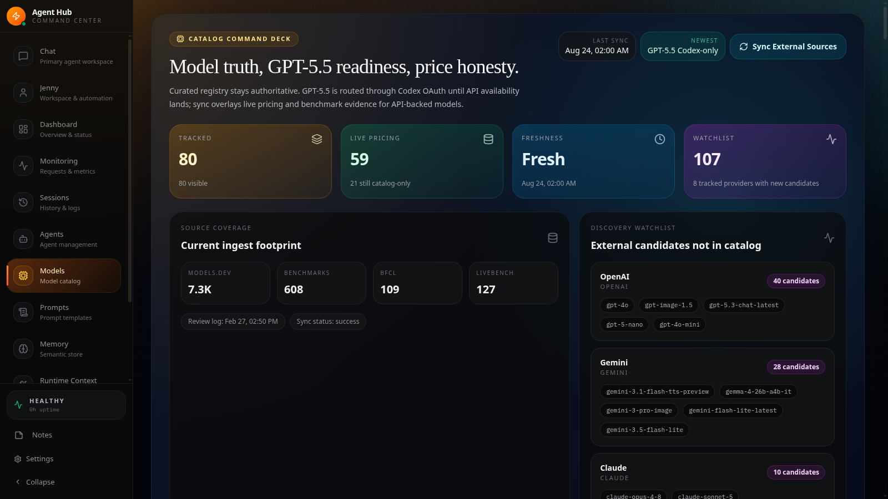
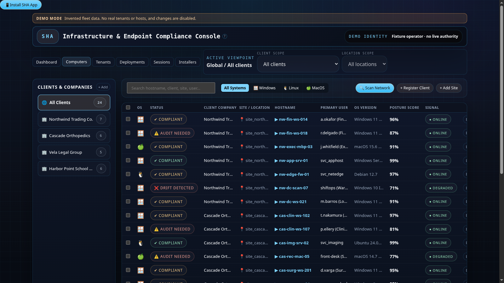
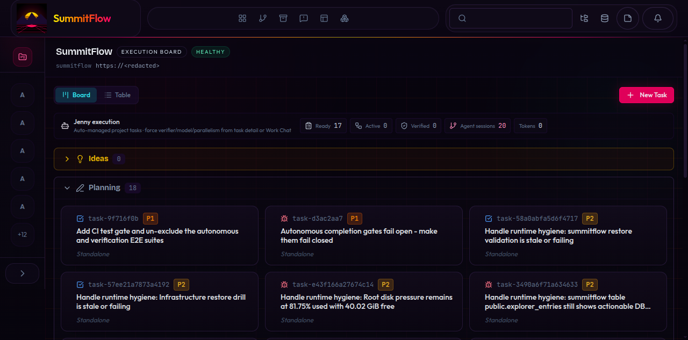
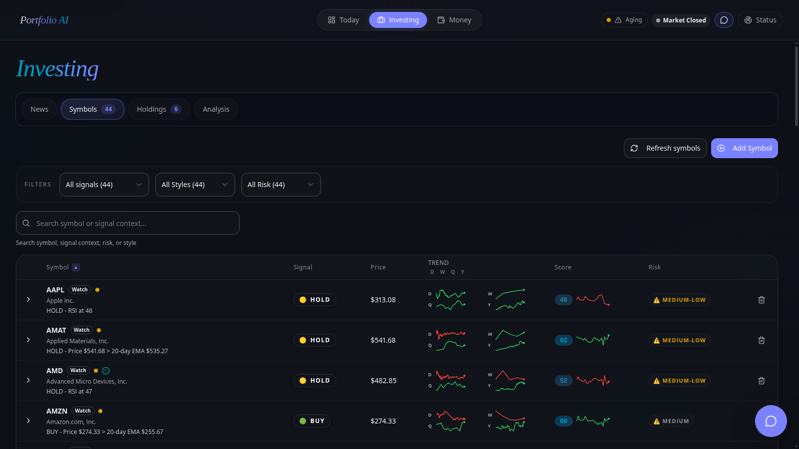
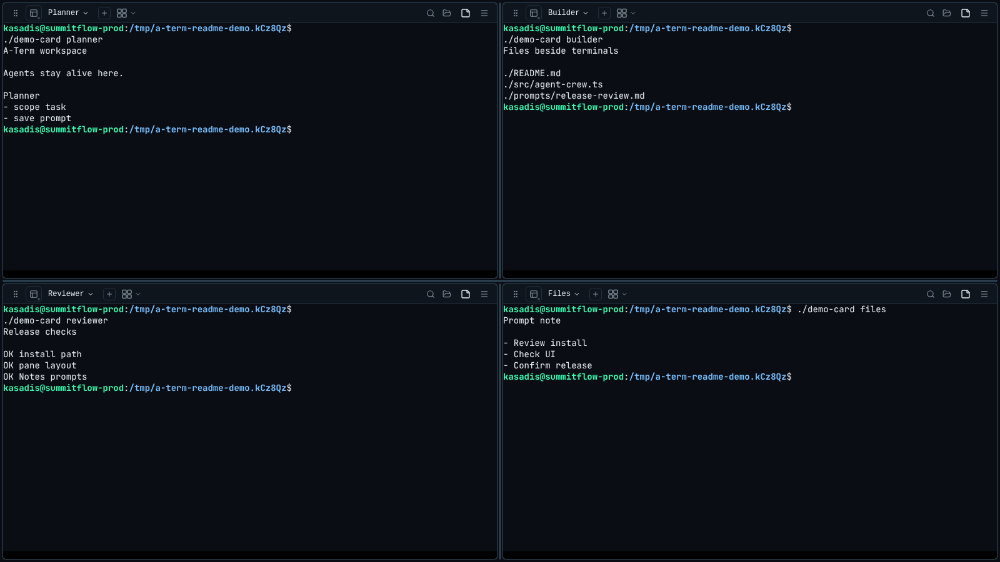
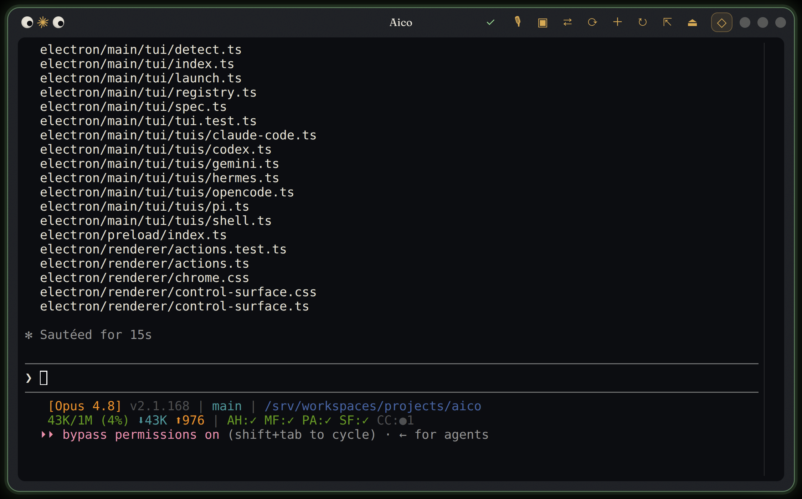

# Elias Leslie: AI, Security Automation, and Infrastructure Tooling

I build practical automation systems at the intersection of **AI automation, security automation, cyber security, agentic developer tooling, and full-stack infrastructure**. My work emphasizes local-first control planes, secure defaults, reproducible release paths, and operator-focused interfaces that turn complex workflows into auditable tools.

I use agentic AI heavily, but I keep the engineering bar concrete: documented setup, real tests, runtime smoke checks, secret hygiene, clean install verification, and honest limitations.

## Background

25+ years in IT and security, spanning hands-on engineering and executive leadership. I grew from Director of IT to Chief Information Security Officer at a managed services provider serving 200+ client environments, building the security program and automation framework that became a key asset in the company's 2024 acquisition by Integris. I then spent the following year as Security Services Architect, refactoring that tooling into platform-agnostic frameworks and mentoring engineers on AI-augmented development.

Alongside that, I served as incident commander on ransomware and breach engagements referred through Lloyd's of London cyber insurance underwriters: seven-figure-ransom recoveries across 26 states and multiple countries, directing client engineering organizations, outsourced IT providers, and third-party vendors. OSCP certified.

The projects below are what that experience looks like when I build in the open.

## Projects

Eight public repositories. Six are released under Apache-2.0 (Agent Hub, SummitFlow, Portfolio AI, Tether, A-Term, and Aico). SHA and Ominull are source-available under the Business Source License 1.1. Each has documented setup, tests, CI, and stated limitations; all but Tether include a security policy.

### Agent Hub: self-hosted control plane for multi-provider AI agents

[Repository](https://github.com/elias-leslie/agent-hub) · [Security policy](https://github.com/elias-leslie/agent-hub/blob/main/SECURITY.md)

- **Problem:** Most agent demos stop at chat. Running agents as real infrastructure needs provider routing, persistent memory, sessions, access control, and cost/latency visibility in one governed place.
- **Solution:** A self-hosted control plane that adds the operational layer: unified completions and SSE streaming across many providers, multi-agent orchestration and server-side tool execution, a pgvector memory-first store with tiered context injection, named agents/personas, session history, request/cost telemetry, access control, and operator dashboards.
- **Stack:** FastAPI, Python 3.13, Next.js 16, React, TypeScript, PostgreSQL with pgvector, Redis, Hatchet, pnpm, uv, plus a sync + async Python SDK.
- **Routing and providers:** Unified completions and streaming across Gemini, OpenAI, OpenRouter, DeepSeek, Kimi/Moonshot, MiniMax, xAI, Zhipu (GLM), NVIDIA, Cloudflare Workers AI, OpenAI Codex, and any local OpenAI-compatible endpoint, with catalog-driven model resolution, per-agent routing with fallbacks, a provider circuit breaker, runtime health probing, and image generation through four vendor adapters (Gemini, NVIDIA, MiniMax, Cloudflare). Model selection is backed by a 6-axis catalog (coding, reasoning, planning, tool use, instruction following, design) carrying per-token, per-image, and per-second pricing.
- **Agents, memory, and orchestration:** A pgvector memory-first store with semantic search, episodes, learning extraction, tiering/promotion/retirement, and citation-tracked context injection; stateful sessions with branching, ingestion, LLM summaries, and token accounting; named agents/personas with version history, a benchmark dashboard, and a self-improving persona heartbeat; a DB-backed prompts catalog with revisions and per-agent assignment; and multi-agent orchestration (a staged clarify → plan → execute → review → QA workflow plus maker-checker, chain, parallel fan-out, sub-agents, code review, and a committee/roundtable) over an agentic server-side tool loop: shell, file read/write/edit, precision code search, and web search/research/fetch backed by SearXNG and a CDP browser.
- **Operability:** Boots without provider keys; encrypted credential storage (Fernet at rest) with OAuth/PKCE, client registration, per-project permissions, budgets/quotas, and cost attribution; request logs, truncation events, and cost/latency analytics behind operator dashboards; optional voice (faster-whisper STT → completion → edge-tts) integration; a sync + async Python SDK; and Hatchet background workflows for session summaries, memory governance, model catalog sync, the persona heartbeat, and retention.
- **Notable engineering decision:** The memory layer originally ran on a Neo4j/Graphiti knowledge graph. I migrated it to a unified pgvector store (semantic search, episodes, learning extraction, tiering/promotion/retirement, and citation-tracked context injection), removing an entire second datastore from the deployment while keeping the retrieval semantics.
- **Design stance:** The individual capabilities exist elsewhere in pieces: Langfuse does tracing, LiteLLM proxies providers, OpenRouter hosts routing. Agent Hub's bet is that routing, memory, sessions, personas, and telemetry belong *integrated and memory-first in one self-hosted control plane* rather than stitched together across four services. Anthropic/Claude is catalogued for reference but deliberately excluded from workload routing; Claude Code runs instead as an external worker that launches the official CLI.
- **Skills demonstrated:** Multi-provider routing, credential boundaries, memory/session infrastructure, schema migration under live semantics, SDK design, operability and observability.
- **Security relevance:** Isolates provider credentials behind access-control surfaces, boots without provider keys (dashboards, health, and sessions stay available), and reports optional integrations as unavailable when they are not configured.
- **Status:** Public Apache-2.0 release. Works standalone and as SummitFlow's routed-agent backend. Expose beyond loopback only behind a reverse proxy with strong client/internal secrets.

### Security Hardening Automation (SHA): bounded control plane for endpoint hardening

[Repository](https://github.com/elias-leslie/sha) · [Security policy](https://github.com/elias-leslie/sha/blob/main/SECURITY.md)

- **Problem:** Endpoint hardening often becomes a brittle mix of one-off scripts, undocumented baseline assumptions, risky remote access, and unclear rollback paths.
- **Solution:** SHA models hardening as a *bounded* control plane: enroll endpoints, collect posture, browse curated controls, generate installer profiles, and route every disruptive action through a typed human approval gate.
- **Stack:** FastAPI, Python 3.13, SQLAlchemy, Alembic, Pydantic, a cross-compiled Go endpoint agent, Next.js 16, React 19, TypeScript, Vitest, pnpm, uv.
- **What was built:** A control-plane API and operator dashboard covering fleet and endpoint inventory, a network discovery scan, controls, installer profiles, approvals, and response-action history. Generated Windows, Linux, and macOS compatibility reporters run concrete read-only posture checks (host firewall, SSH configuration, root password lock, automatic updates, Microsoft Defender, BitLocker, Secure Boot, FileVault, Gatekeeper) through an enroll → heartbeat → posture → action-claim → lease-bound-result cycle. A deterministic, provenance-pinned catalog builder produces 4 starter control packs (17 controls) from public NIST SP 800-53 Rev. 5, DISA Windows Server 2022 STIG, and CISA/NSA guidance, each control carrying NIST CSF / SP 800-53 / STIG / CISA mappings. A typed human-in-the-loop approval workflow has bounded grant TTLs (15 to 240 minutes), manual emergency grants, and append-only audit events. Action delivery is lease-bound and idempotent, behind fail-closed OIDC browser sessions with scoped roles and CSRF/origin enforcement. Linux and Windows have reversible typed hardening actions with rollback artifacts; macOS is observe-only. Posture rolls up into weighted per-endpoint scores and a control drift matrix. A cross-compiled Go agent with enrollment tokens, per-device credentials, and signed release bundles is the path that replaces the compatibility reporters.
- **Demonstrable without a fleet:** The console ships an explicitly enabled demo mode that answers every read from an invented tenant set and refuses every mutation, so it can be screen-shared or published without exposing a real deployment. The screenshot above is that mode.
- **Design stance:** No shell or arbitrary-command endpoint exists anywhere in the API. SHA sits deliberately between pure auditors (Lynis, OpenSCAP) and unbounded appliers (ansible-lockdown, Wazuh active response): every disruptive action is a typed capability behind a mandatory approval gate.
- **Skills demonstrated:** Security automation design, public-source provenance discipline, approval-boundary modeling, cross-platform agent development, full-stack testing, and clean install verification.
- **Status:** Early-stage working control-plane slice, not a production-ready endpoint-management product. Native DEB/RPM/MSI distribution, macOS runtime acceptance, and broader production readiness remain open. Source-available under the Business Source License 1.1.

### Ominull: self-hosted endpoint telemetry, detection, and containment hub

[Repository](https://github.com/elias-leslie/ominull) · [Security policy](https://github.com/elias-leslie/ominull/blob/main/SECURITY.md)

- **Problem:** Operators of small Linux and Windows fleets need to see which programs talk to which networks, notice the behavior that matters, and contain a host when needed, without sending fleet data to a hosted EDR service or losing the ability to recover the host.
- **Solution:** A self-hosted Linux hub with native Linux and Windows agents. It combines a fleet console, observed communication evidence, per-device identity, behavioral detection with operator tuning, and bounded response controls.
- **Stack:** Go hub with an embedded operator console and SQLite store; C endpoint agents for Linux and Windows; signed Linux `.deb` and Windows `.msi` packages; systemd; OIDC and optional Cloudflare Tunnel/Access.
- **Telemetry and evidence:** Agents report TCP socket-counter observations and passive UDP socket observations (a libbpf CO-RE program on Linux, an ETW consumer on Windows) with process attribution and stated coverage limits. Observation records are bounded evidence, not packet capture or proof of complete network visibility. A topology workspace groups communication by asset, network, and process without merging hosts on a shared name, and optional router telemetry adds DHCP leases, conntrack flows, and DNS answers without putting the hub in the network path.
- **Detection:** Per-process transfer baselines scored with a robust modified z-score (median and MAD), beaconing detection that requires both regular timing and uniform payload size, agent-silence alerts, threat-intelligence and published network-attribution matching, and an on-demand subnet scanner that shows the evidence behind each identification. Learning windows produce tuning proposals that apply only when an operator accepts them.
- **Response:** Host isolation is gated by a readiness check: the hub compares the services an endpoint uses against its baseline policy and rejects isolation that would break something uncovered, unless an administrator records an audited emergency override. Linux applies Ominull-owned iptables/ip6tables rules and Windows applies user-mode Windows Filtering Platform rules. A dead-man timer releases isolation if the hub becomes unreachable, a standalone Windows recovery tool removes only Ominull's filters, and mesh quarantine lets retained agents block a named peer. Privileged response actions go through a separate response-authority service.
- **Identity and lifecycle:** Enrollment profiles (invitation, campaign, deployment) issue a unique device credential and a matching client certificate per endpoint. The bootstrap verifies the package digest and detached ECDSA signature before invoking `dpkg` or Windows Installer, and agents self-update only after checking the package against a release key pinned in the binary.
- **Engineering decision:** I cut the product down to what it can prove. An earlier version carried an unused Windows kernel driver and DPI code, an embedded AI copilot, macOS support, policy groups that only labeled traffic, and an SSH push deployer. I removed them, described the remaining enforcement exactly as implemented, and finished native package lifecycle for the platforms that stayed.
- **Skills demonstrated:** Go and C systems programming, Linux and Windows network telemetry, robust statistics for detection, safe containment design, device PKI and signed package lifecycle, and honest scope reduction.
- **Security relevance:** Keeps fleet telemetry on infrastructure the operator controls, uses unique per-device credentials and client certificates, fails closed on unsafe isolation, and keeps a recovery path for every enforcement state it creates.
- **Status:** Supported products are the Debian-family Linux hub `.deb`, Linux agent `.deb`, and Windows agent `.msi`. macOS is out of scope. Source-available under the Business Source License 1.1.

### SummitFlow: task orchestration and evidence capture for AI-assisted development

[Repository](https://github.com/elias-leslie/summitflow) · [Security policy](https://github.com/elias-leslie/summitflow/blob/main/SECURITY.md)

- **Problem:** AI-assisted development scatters task state, quality gates, and verification evidence across one-off scripts and chat logs, so it is hard to see what was actually built, checked, and proven across projects.
- **Solution:** A self-hosted project operations control plane that tracks tasks, subtasks, steps, and dependencies; runs quality gates and code-health scans; coordinates parallel agents; and keeps operator-visible verification evidence. Built for developers running their own agent tooling, not as a hosted SaaS.
- **Stack:** FastAPI, Python 3.13, SQLAlchemy, Alembic, Next.js 16, React, TypeScript, PostgreSQL, Redis, Hatchet, pnpm, uv, plus a Rust host monitor.
- **What was built:** A FastAPI backend (about 300 API routes) and a Next.js operator UI, driven by the `st` CLI with about 80 top-level commands spanning task lifecycle (claim leasing, dependencies, JSONB-stored verification/review evidence, cross-agent coordination and a preflight gate), quality gates (ruff, types, pytest, biome, tsc, vitest, sqlfluff, squawk, CodeQL alert state, and an isolated cleanroom run), checked Git checkpoints with explicit publication, services and runtime, databases and migrations, browser/UI automation, agents, file-level leases, and backups.
- **Automation and operations:** Hatchet workflows for maintenance (stale-claim reset, code-explorer scans, search-index refresh, backups, retention, production smoke tests, runtime hygiene) and Agent Hub automation dispatch; `radon` complexity assessment, code-graph topology and JS/TS dead-code audits, and precision symbol/endpoint/table search; Btrfs per-project snapshots and a backup engine with SMB and Veeam targets and restore drills; and `summitflow-host-monitor`, an unprivileged Rust collector for host, service, and process metrics.
- **Design stance: proof it ran.** The differentiator is evidence, not tracking. Managed browser checks capture screenshots, page snapshots, and console state; quality-gate and review results are stored as JSONB on the task, so "done" points to evidence a reviewer can open, not a status field someone set. Agents always claim work explicitly; SummitFlow does not pick up or generate tasks on its own.
- **Skills demonstrated:** Full-stack system design, workflow orchestration, CLI and developer-tooling design, runtime smoke verification, and public release discipline (secret/history scanning, dependency remediation, clean install verification).
- **Security relevance:** Keeps agent work local-first and auditable, and degrades clearly when optional integrations (Agent Hub, Hatchet, browser runtime, push notifications, SMB backups) are absent instead of exposing credentials or crashing unrelated pages.
- **Status:** Public Apache-2.0 release. Pairs with Agent Hub for routed AI completions and shared memory, but runs standalone.

### Portfolio AI: self-hosted investment, household, and rewards workspace

[Repository](https://github.com/elias-leslie/portfolio-ai) · [Security policy](https://github.com/elias-leslie/portfolio-ai/blob/main/SECURITY.md)

- **Problem:** Self-hosted personal-finance tools split into three camps that do not talk to each other (portfolio trackers, household budgeters, and research terminals), and the ones that bolt on AI let a language model invent the numbers it then reasons about.
- **Solution:** One self-hosted workspace that spans all three, built on a deterministic analytical core: portfolio and tax-lot tracking, a scored research watchlist with plain-language narratives, a macro deployment gate, monthly household money review, retirement planning, and a credit-card rewards engine, all on data you host, with AI confined to the edges where judgment over unstructured input is the actual problem.
- **Stack:** FastAPI, Python 3.13, SQLAlchemy 2, Alembic, Pydantic 2, Next.js 16, React 19, Tailwind CSS 4, PostgreSQL 16, Redis, Hatchet, pandas, scikit-learn, pandas-ta; yfinance, CBOE, and SEC EDGAR with no key required, plus optional FRED, TwelveData, FMP, Polygon, Finnhub, and AlphaVantage.
- **Investing core:** Portfolio, account, position, tax-lot, transaction, and snapshot tracking with lot-level cost basis and P&L, tax-loss harvesting with wash-sale checks, and IPS target/drift/rebalance planning; a multi-pillar watchlist scorer (price, technical, fundamental, catalyst, options) producing per-symbol composites with plain-language narratives over an S&P 500 research universe that discovers and trims its own candidates; a macro deployment gate (FULL_DEPLOY / REDUCED / DEFENSIVE) computed from VIX term structure, credit spreads, put/call, breadth, and factor crowding, with walk-forward and Monte Carlo backtests; technical analysis (RSI, MACD, Bollinger Bands, ATR, VWAP) and a lightweight ML layer (a scikit-learn article-quality classifier and TF-IDF news clustering) over ingested OHLCV, intraday, fundamentals, macro, and RSS news; a forward catalyst calendar; and about 60 Hatchet workflows covering ingestion, scoring, catalysts, strategy research, data-freshness monitoring, and maintenance.
- **Household money and rewards:** A monthly money review with category netting and planned funding, Monte Carlo retirement scenarios, document intake, encrypted Plaid and SnapTrade credentials, and family receipt/shelf-tag capture with member-scoped access; plus a household credit-card surface: catalog-driven rewards ranking, a two-player 90-day rotation planner that models issuer rules such as Chase 5/24 and Amex once-per-lifetime bonuses, keeper-card spend routing, welcome-bonus tracking that accounts for soft and provisional charges, AI review of uploaded offer screenshots, catalog research, and household web push alerts.
- **Design stance: deterministic core, agents at the edges.** Every number the app acts on (pillar scores, the macro gate, volatility, drift, retirement projections, card economics) is computed in Python from stored data and saved inputs, so it is reproducible and back-testable. Agents are used only where unstructured input is the problem: reading a statement, receipt, or offer screenshot, evaluating a thesis against the evidence, and explaining the canonical calculations. Agent reviews are labeled as such and never replace the deterministic signal, and all LLM access routes through Agent Hub.
- **Interfaces:** A Next.js operator UI, a documented FastAPI surface (portfolio, watchlist, symbols, market, macro, thesis, catalysts, retirement, household, cards), and a read-only MCP server (`portfolio-ai-mcp`) exposing three deterministic stdio tools (`get_deployment_zone`, `get_deployment_history`, `get_symbol_full_picture`) so an MCP client can query the signal stack without triggering model inference.
- **Skills demonstrated:** Multi-source data pipelines, quantitative and technical analysis, lightweight ML, rules-engine modeling of external policy, workflow orchestration at scale, MCP server design, full-stack reporting UI, and privacy-aware public documentation.
- **Security relevance:** Boots without optional keys (degrading rather than failing), encrypts provider credentials at rest, keeps all LLM access behind Agent Hub, and publishes only synthetic claims: no real balances, holdings, transactions, account IDs, or live portfolio values.
- **Status:** Public Apache-2.0 release; users configure their own data sources and secrets. Not investment advice, and it places no trades: it produces analysis, not orders.

### Tether: session daemon behind A-Term and Aico

[Repository](https://github.com/elias-leslie/tether)

- **Problem:** A-Term and Aico each grew their own tmux lifecycle, so the same agent session had two owners, two catalogs and two ways to end it, and the apps had to federate with each other to see each other's work.
- **Solution:** A per-user Linux daemon that owns every durable terminal session. The apps keep only their views (Aico windows, A-Term panes) and ask Tether to create, rename, resize and end sessions. Either app works alone against Tether, and both can share one instance.
- **Stack:** TypeScript on Node.js 22 (`node:sqlite`), esbuild single-file bundle, systemd user units, cgroup v2, tmux; Python operator scripts.
- **What was built:** A versioned HTTP API on a private 0600 Unix socket, never exposed on the network; private tmux servers in their own systemd units with one scope per pane and a memory guard; generation fencing, so every mutation names the exact workload it read and a changed workload is never a retry target; explicit End and respawn, with no silent resurrection; root requests with tombstones, so a retried request ID reconciles instead of launching twice; a shared agent-tool registry and a project list sourced from SummitFlow when installed; an event stream with gap resync; an active-client resize claim; a GUI channel that forwards show, position and title to the connected Aico desktop; and the legacy Aico control sockets kept for existing callers. An idempotent importer moved Aico's catalog over during a live cutover in which the running sessions kept their identities.
- **Design stance:** One authority for the workload, many views of it. Closing a window or a browser tab only detaches a client; ending a session is a separate, explicit action that Tether performs whichever app asks.
- **Skills demonstrated:** Process containment with systemd and cgroups, API and compatibility-contract design, idempotent data migration, and a live cutover that kept running sessions attached.
- **Security relevance:** Socket-only API with 0600 permissions, an allow-listed environment for every tmux server, no app `.env` loading, and contained process trees that End can retire completely.
- **Status:** Public Apache-2.0 release, v0.1.0, API v1. Runs on Linux with systemd 254+, cgroup v2 and user lingering. Install it before A-Term or Aico.

### A-Term: browser workspace for AI coding agents

[Repository](https://github.com/elias-leslie/a-term) · [Security policy](https://github.com/elias-leslie/a-term/blob/main/SECURITY.md)

- **Problem:** Agentic coding needs several shells and agents next to project files in one place you can reach from any device, and naive web terminals lose their session the moment the tab closes.
- **Solution:** A self-hosted browser workspace that shows persistent terminal sessions (Claude Code, Codex, Antigravity, Pi, and shells) side by side in a resizable pane grid, with a file browser, voice input and full mobile support. The sessions live in Tether, so they keep running when the browser closes, and the same sessions open in Aico.
- **Stack:** FastAPI, Python 3.13, SQLite, Next.js 16, React 19, TypeScript, xterm.js (WebGL), tmux, Tailwind CSS 4, pnpm, uv; Tether for sessions.
- **What was built:** WebSocket PTY terminals that attach to Tether's tmux sessions, so sessions survive browser and server restarts; up to six resizable panes with detach-to-window; per-pane shell or agent mode using Tether's shared tool registry; a view-state store (panes, layout, project display settings) in a local SQLite file, with no database server; a sandboxed file browser with validated uploads; Agent Hub prompt cleaning; browser-native voice input; an on-screen keyboard and PWA install for mobile; and three auth modes (loopback, password, proxy) with security headers, CSP and rate limiting. The move to Tether removed Postgres, the notes and prompt library, and session recording.
- **Design stance:** Browser terminals, modern desktop terminals and tmux each solve one part of this. A-Term is not trying to replace a terminal emulator. It puts several agents, durable sessions and project files into one workspace reachable from any device, self-hosted, with no account or cloud service.
- **Skills demonstrated:** Real-time WebSocket/PTY streaming with backpressure, client design against a session daemon, data migration off Postgres, mobile/PWA support, and secure-by-default remote access.
- **Security relevance:** Ships loopback-only by default, isolates the file browser against path traversal, keeps A-Term authentication on every route that reaches Tether, and keeps agent working context local instead of in a hosted service.
- **Status:** Public Apache-2.0 release. Requires Tether API v1. Projects come from SummitFlow when installed, otherwise from Tether's local list; Agent Hub adds prompt cleaning and a model catalog.

### Aico: desktop companion for terminal AI agents

[Repository](https://github.com/elias-leslie/aico) · [Security policy](https://github.com/elias-leslie/aico/blob/main/SECURITY.md)

- **Problem:** Terminal AI agents are useful but fragmented across shells, browser context, desktop selection and project state, and the thing you want the agent to look at is almost always already on your screen.
- **Solution:** A Linux desktop companion that shows terminal AI CLIs (Claude Code, Codex, Gemini/Antigravity, Pi, and shells) in floating "lantern" widgets, then lets you tag a browser page, a selection, a window or a screen region straight into the running agent's prompt. Each widget is a view of a Tether session, so the same session also opens in A-Term.
- **Stack:** Electron, TypeScript, Vite, xterm.js, node-pty, FastAPI, Python 3.13, SQLite, tmux, uv, Node.js, MV3 browser extension APIs; Tether for sessions.
- **What was built:** Frameless terminal widgets that attach to Tether sessions and remember their geometry per session; closing a widget only detaches, so work reattaches across close, reopen and restart; one session list covering everything started from Aico, A-Term, the `tether` CLI or a SummitFlow root; a searchable command palette and pinned, drag-reorderable controls over one action registry; an agent launcher that swaps the TUI in a focused widget; Tether's lifecycle diagnostics (tmux target, scope, age, CPU and memory, containment warnings) one click away; a read-only scrollback overlay; a loopback FastAPI sidecar and MV3 browser extension for click-to-context capture; optional desktop window, region and OCR grab and voice dictation; and an AppImage build with a bundled PyInstaller sidecar, CI and release hardening (SHA256SUMS and build provenance).
- **Design stance:** Deliberate, on-demand tagging rather than always-on recording. Screen-history tools capture everything and make you search it later; other launchers route capture into their own chat. Aico's target is *your* terminal agent, on Linux, with capture happening only when you ask for it.
- **Skills demonstrated:** Desktop/Electron integration, local sidecar API design, client design against a session daemon, browser-context capture, and release hardening.
- **Security relevance:** Keeps sensitive workflow state local by default, uses loopback APIs and a private socket, captures only on explicit action, and degrades when optional integrations are absent.
- **Status:** Public Apache-2.0 release for single-user Linux desktops. Requires Tether API v1. X11 is the best-supported path for global shortcuts and desktop capture; Wayland has limitations.

## Private work

**BlackBox: zero-knowledge encrypted media archive.** A private household archive spanning a Kotlin/Jetpack Compose Android client and a Go vault service, built around nine documented security invariants that a change may not weaken without a recorded decision. Media is sealed with AES-256-GCM under Android Keystore (StrongBox where available) *before* it is written to disk, so plaintext never reaches storage; there is no write path to `MediaStore` or any shared collection, no exported provider or `FileProvider`, `allowBackup=false`, and `FLAG_SECURE` on every window. The vault server never holds a media decryption key.

Every device generates a P-256 key at first run and its identity *is* the SHA-256 of that public key, so listeners present a self-signed certificate whose key is the identity key and pinning an invitation fingerprint authenticates the specific device rather than a name a CA could reissue. Recovery runs through a five-word EFF-long-list passphrase (64.6 bits) stretched with Argon2id (64 MiB, t=3), with the archive publishing only salt, cost parameters, and a public key. Storage is content-addressed and immutable with additive mirroring, copy-census-gated eviction, and tombstoned deletes that still reach an archive drive that was offline at the time.

Source is private, but I am happy to walk through the architecture and threat model on request.

## Capability areas

- **Security leadership:** security program design, fractional CISO governance, board and underwriter communication, incident command, third-party risk, CMMC/DFARS/HIPAA/PCI/CJIS compliance.
- **Security automation:** endpoint hardening, control-catalog provenance, approval boundaries, incident containment, detection workflows, evidence exports, rollout/rollback discipline.
- **AI automation and agentic tooling:** multi-provider control planes, local-first agent workflows, prompt/session/memory infrastructure, terminal and browser context capture, supervised automation boundaries.
- **Cyber security engineering:** secure defaults, applied cryptography and key management, device PKI, secret scanning, local API boundaries, signed package and install-time verification, public release hygiene.
- **Full-stack infrastructure:** FastAPI, Go, Next.js/Electron, PostgreSQL/pgvector/Redis/SQLite, workflow orchestration, operator dashboards, Linux service and runtime integration.

## Contact

- LinkedIn: <https://linkedin.com/in/elias-leslie>
- GitHub: <https://github.com/elias-leslie>

_Last updated: 2026-10-11_
